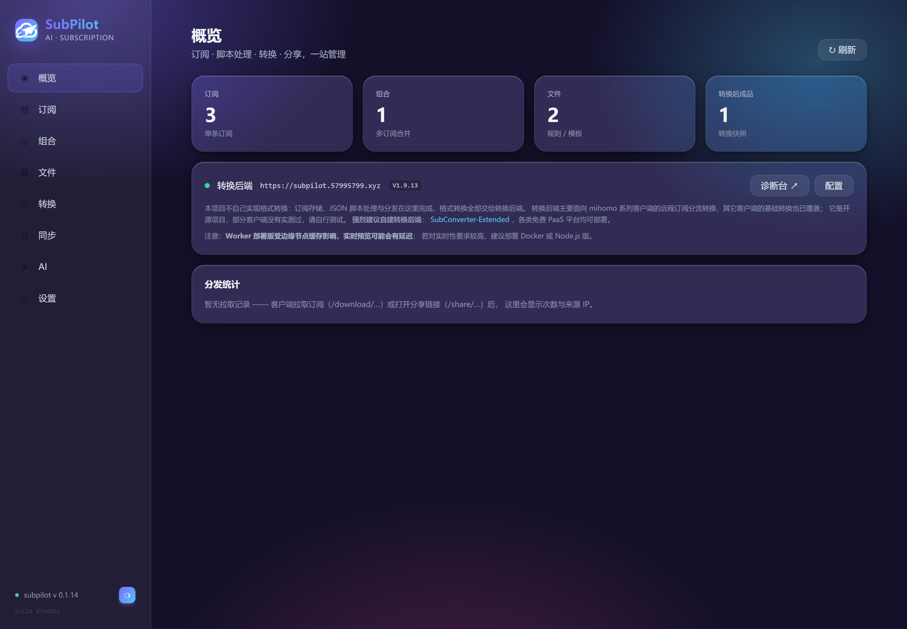
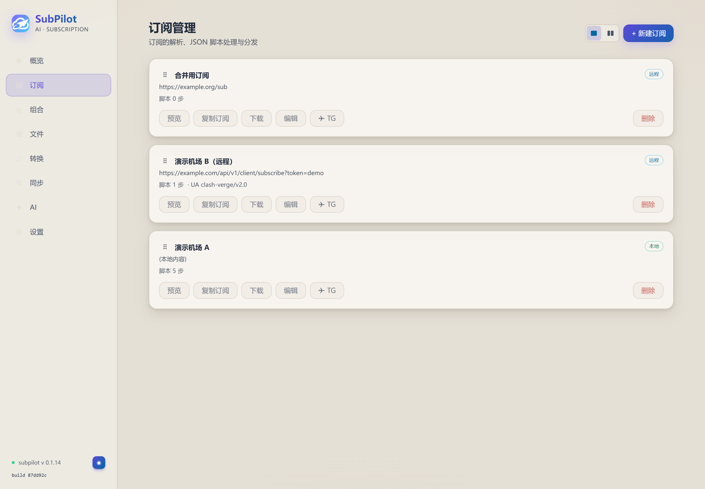
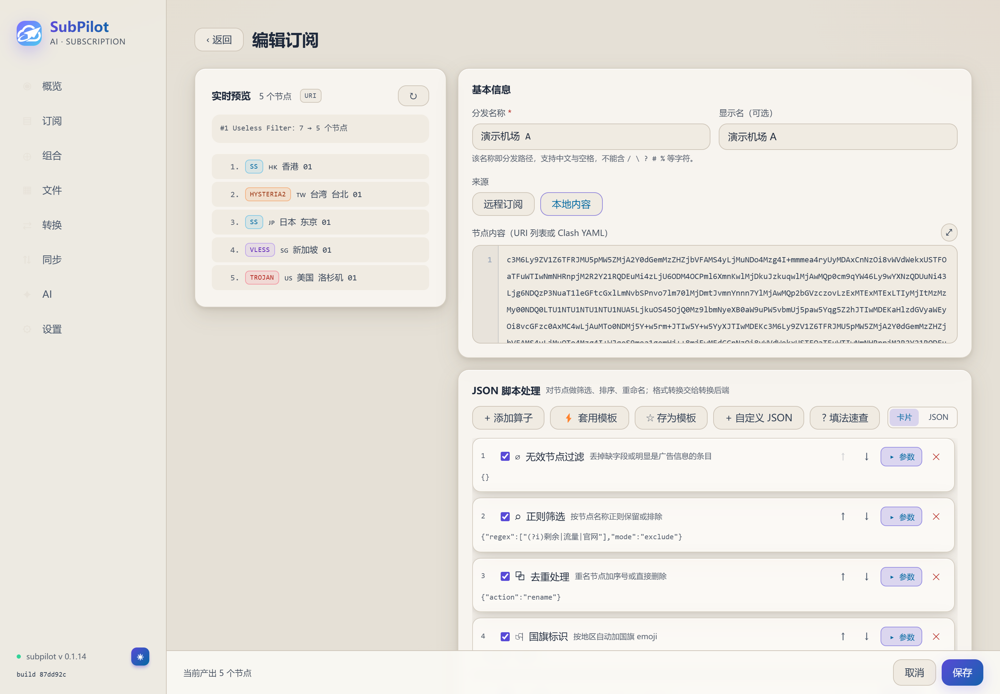
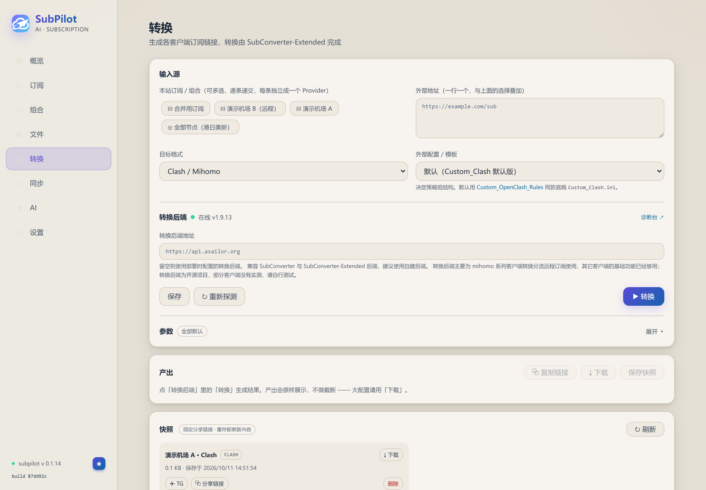
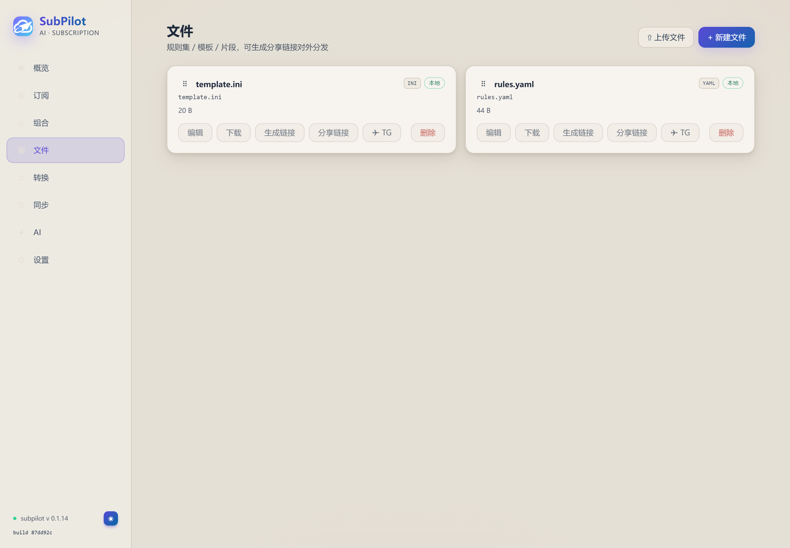
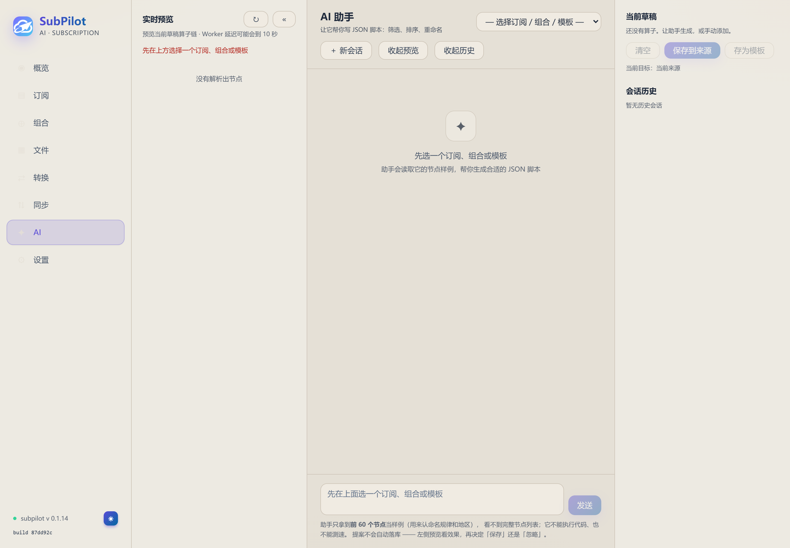

# SubPilot

> **当前分支 `main`** —— Cloudflare Worker 部署版（KV 存储 + QuickJS WASM 脚本沙箱）
> · Docker / Node.js 自建部署请看 [`dev` 分支](../../tree/dev)

一体化订阅管理面板：**订阅管理 · 节点拼接（组合）· 格式转换 · 文件与文档管理 · AI 助手**。

前端是 Vue 3 单页应用；后端部署到 **Cloudflare Worker**，存储用 KV。

```
浏览器（Vue 3 SPA）
  订阅 · 组合 · 文件 · 转换 · 同步 · AI 助手 · 设置
        │
        │  /api/*（Bearer 令牌）
        ▼
SubPilot Worker ───────────────────────────────────────────────
   ├── 存储        KV（Cloudflare）
   │               订阅 / 组合 / 文件 / 成品 / 分享码 / 设置
   ├── 节点处理    解析 + JSON 算子链（筛选 / 排序 / 重命名 / 去重 / 自定义脚本 …）
   ├── 文档管理    规则集 / 模板 / 片段，生成链接与分享链接
   ├── AI 助手     OpenAI 兼容接口 SSE 代理（API Key 不下发浏览器）
   ├── 同步推送    Gist / WebDAV 备份恢复、Telegram 推送
   └── 转换        调用转换后端 ──► Clash / sing-box / Shadowrocket …
                     ▲
        /feed/* ─────┘  供后端回拉处理后的节点
        /download/*、/share/*   客户端直接拉取（只读分发密钥）
```

[本项目默认后端版本](https://subpilot.57995799.xyz/version)

基于 [SubConverter-Extended](https://github.com/Aethersailor/SubConverter-Extended)

该实例由作者自建、**公益免费提供**，`SUB_BACKEND` 已预置此地址，开箱即用；
不承诺可用性与稳定性，请勿滥用，有稳定性要求请换自建后端。

**出处引用**：算子链 DSL 与 [Sub-Store](https://github.com/sub-store-org/Sub-Store) 保持兼容；
完整第三方声明见 `NOTICE` 与文末「许可」。

## 截图

| | |
| --- | --- |
|  |  |
|  |  |
|  |  |

更多页面与亮色 / 暗色 / 玻璃三种主题的对比见 [shots/](shots/)。

## 部署

### Cloudflare Worker（一键部署）

点下面的按钮，授权 GitHub 与 Cloudflare，其余都在网页上完成：

[](https://deploy.workers.cloudflare.com/?url=https://github.com/guanxi660-crypto/SubPilot)

部署表单里**只有一个必填项**：

| 表单项 | 怎么填 |
| --- | --- |
| 项目名称 | 默认 `subpilot`，可改 |
| `SUBPILOT_TOKEN` | **唯一要填的**。填一个随机串（建议 `openssl rand -hex 24`）或 UUID，这就是登录令牌 |
| `SUB_BACKEND` | 已预填默认值，**不用动** |
| 启用预构建 | 保持开启（部署时自动构建前端） |

点「部署」即可，KV 等资源由部署流程按 `wrangler.jsonc` 的声明自动创建并绑定。
完成后打开分配的 `*.workers.dev` 地址（或你绑定的自定义域），输入刚才填的
`SUBPILOT_TOKEN` 登录。

**换自定义域名**：Dashboard → Worker → Settings → Domains & Routes 解绑 / 绑定即可。
注意已生成的客户端配置里嵌的是**当时请求的 host**，换域后旧的 `/feed/...`、`/download/...`
地址会失效，需要重新分发。

### Docker / Node.js 自建部署

> Docker、Node.js、免费容器平台（Render / Railway / Koyeb 等）的部署方式已移至
> [`dev` 分支](../../tree/dev#部署)。该分支包含 SQLite 存储、Dockerfile、docker-compose.yml、
> Node 适配层（`apps/server/node/`）以及对应的 README 说明。

### 本地开发

```bash
npm run install:all
npm run dev:server
npm run dev:web
```

三条命令依次是：

| 命令 | 作用 |
| --- | --- |
| `npm run install:all` | 安装前后端依赖（逐个包安装，不用 workspaces） |
| `npm run dev:server` | 起后端（Worker 形态，`wrangler dev`） |
| `npm run dev:web` | 起前端 dev server |

后端跑起来后打开 `http://127.0.0.1:8795`，令牌填 `dev-local-token`
（该值来自 `apps/server/wrangler.dev.jsonc`）。前端 dev server 在
`http://127.0.0.1:5175`，只改界面时用它更方便。

> **改完前端要重启服务。** Worker 的 assets 清单在启动时快照，重新 build 后
> 新 hash 的 JS 会 404（`index.html` 已指向新文件，表现为白屏 + 两个 404）。

### 环境变量

| 变量 | 默认 | 说明 |
| --- | --- | --- |
| `SUBPILOT_TOKEN` | 空 | **访问令牌，为空时所有受保护接口 401**（fail-closed）。必填 |
| `SUB_BACKEND` | `https://subpilot.57995799.xyz` | 转换后端（SCE）地址。**项目已预置公益默认后端，留空即用它**；想换自建实例就填自己的地址，也可登录后在「转换」页改 |

## 许可

AGPL-3.0-only，见 [LICENSE](LICENSE)。第三方组件与出处见 [NOTICE](NOTICE)。