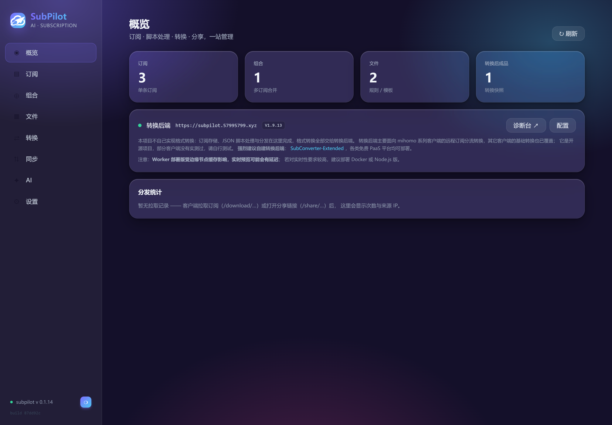
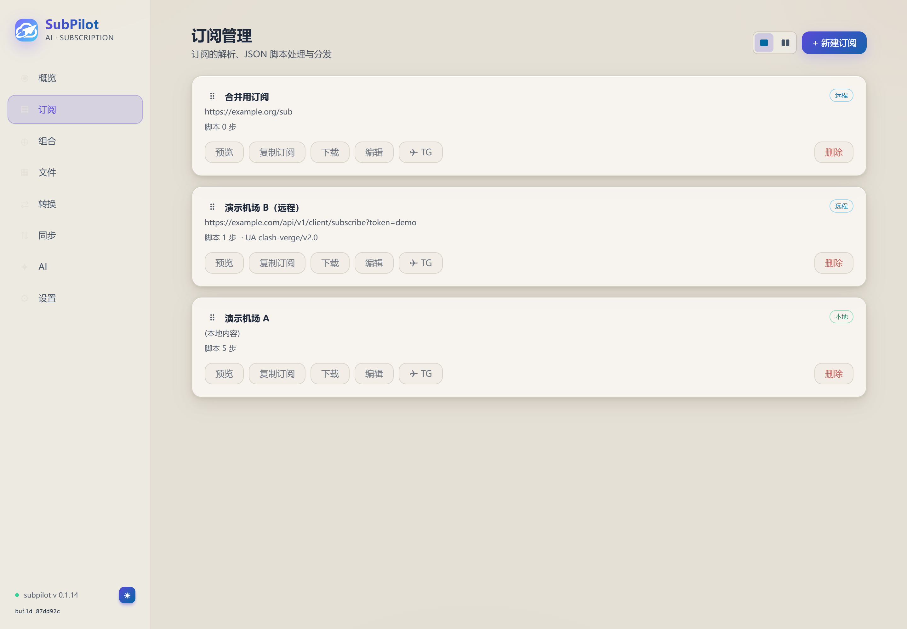
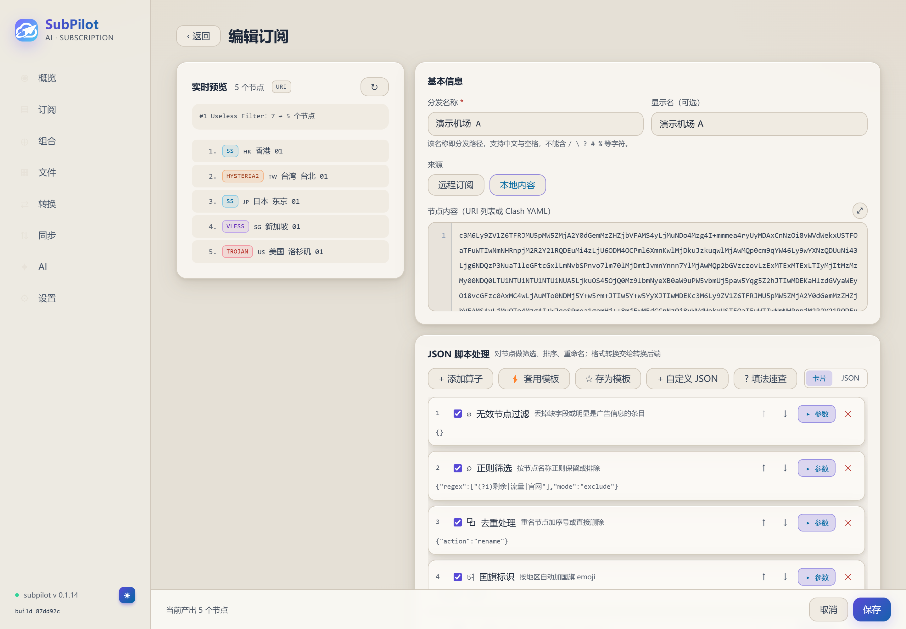
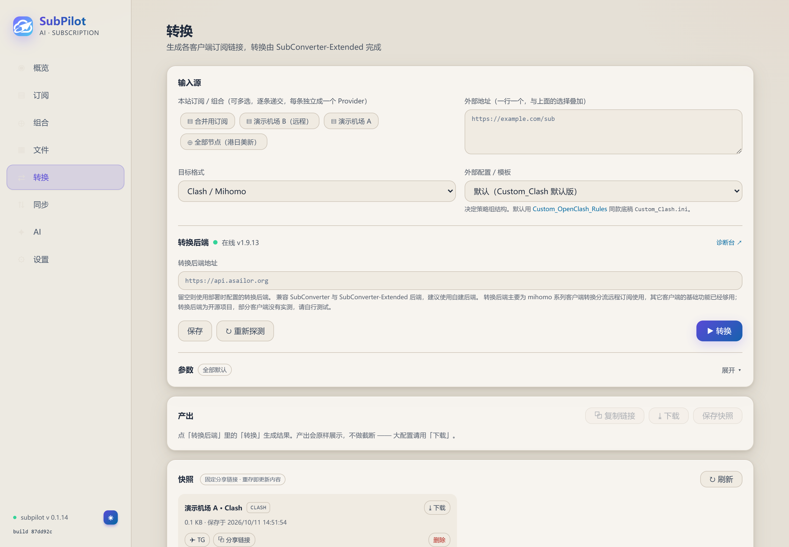
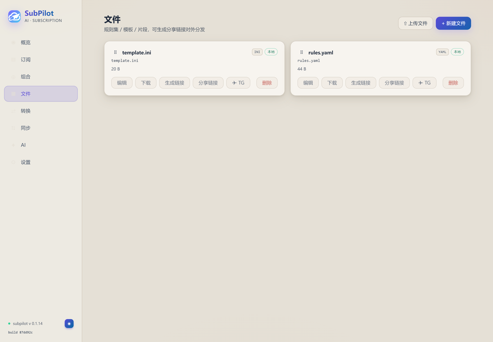
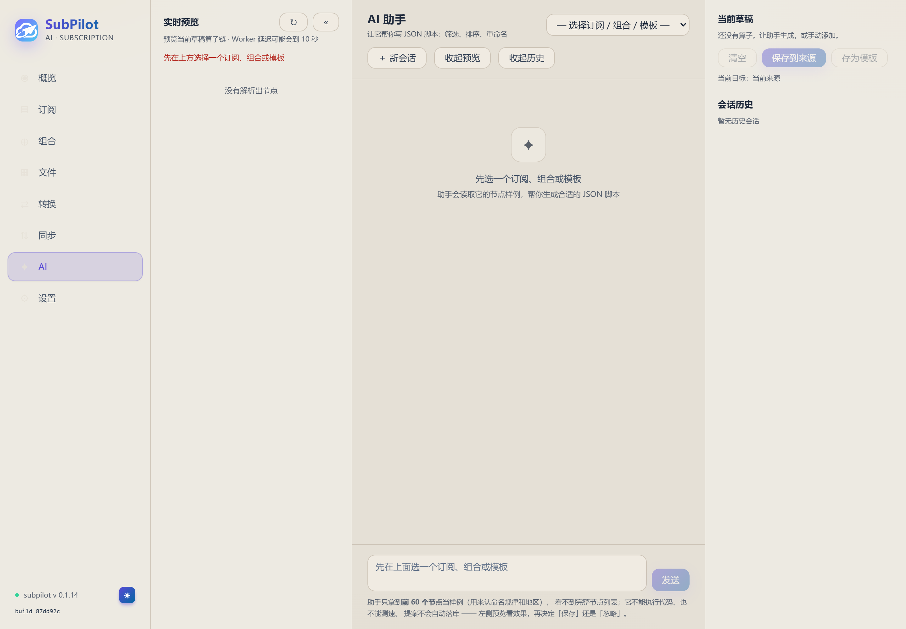

# SubPilot

> **当前分支 `main`** —— Cloudflare Worker 部署版（KV 存储 + QuickJS WASM 脚本沙箱）
> · Docker / Node.js 自建部署请看 [`dev` 分支](../../tree/dev)

一体化订阅管理面板：**订阅管理 · 节点拼接（组合）· 格式转换 · 文件与文档管理 · AI 助手**。

前端是 Vue 3 单页应用；后端部署到 **Cloudflare Worker**，存储用 KV。

```
浏览器（Vue 3 SPA）
  订阅 · 组合 · 文件 · 转换 · 同步 · AI 助手 · 设置
        │
        │  /api/*（Bearer 令牌）
        ▼
SubPilot Worker ───────────────────────────────────────────────
   ├── 存储        KV（Cloudflare）
   │               订阅 / 组合 / 文件 / 成品 / 分享码 / 设置
   ├── 节点处理    解析 + JSON 算子链（筛选 / 排序 / 重命名 / 去重 / 自定义脚本 …）
   ├── 文档管理    规则集 / 模板 / 片段，生成链接与分享链接
   ├── AI 助手     OpenAI 兼容接口 SSE 代理（API Key 不下发浏览器）
   ├── 同步推送    Gist / WebDAV 备份恢复、Telegram 推送
   └── 转换        调用转换后端 ──► Clash / sing-box / Shadowrocket …
                     ▲
        /feed/* ─────┘  供后端回拉处理后的节点
        /download/*、/share/*   客户端直接拉取（只读分发密钥）
```

[本项目默认转换后端版本](https://subpilot.57995799.xyz/version) · 基于 [SubConverter-Extended](https://github.com/Aethersailor/SubConverter-Extended) 

该后端实例由作者自建、**公益免费提供**，`SUB_BACKEND` 已预置此地址，开箱即用；
不承诺可用性与稳定性，请勿滥用，有稳定性要求请换自建后端。

**出处引用**：算子链 DSL 与 [Sub-Store](https://github.com/sub-store-org/Sub-Store) 部分兼容；
完整第三方声明见 `NOTICE` 与文末「许可」。

## 截图

| | |
| --- | --- |
|  |  |
|  |  |
|  |  |

更多页面与亮色 / 暗色 / 玻璃三种主题的对比见 [shots/](shots/)。

## 部署

### Cloudflare Worker（一键部署）

点下面的按钮，授权 GitHub 与 Cloudflare，其余都在网页上完成：

[](https://deploy.workers.cloudflare.com/?url=https://github.com/guanxi660-crypto/SubPilot)

部署表单里**只有一个必填项**：

| 表单项 | 怎么填 |
| --- | --- |
| 项目名称 | 默认 `subpilot`，可改 |
| `SUBPILOT_TOKEN` | **唯一要填的**。填一个随机串（建议 `openssl rand -hex 24`）或 UUID，这就是登录令牌 |
| `SUB_BACKEND` | 已预填默认值，**不用动** |
| 启用预构建 | 保持开启（部署时自动构建前端） |

点「部署」即可，KV 等资源由部署流程按 `wrangler.jsonc` 的声明自动创建并绑定。
完成后打开分配的 `*.workers.dev` 地址（或你绑定的自定义域），输入刚才填的
`SUBPILOT_TOKEN` 登录。

**换自定义域名**：Dashboard → Worker → Settings → Domains & Routes 解绑 / 绑定即可。
注意已生成的客户端配置里嵌的是**当时请求的 host**，换域后旧的 `/feed/...`、`/download/...`
地址会失效，需要重新分发。

### Docker / Node.js 自建部署

> Docker、Node.js、免费容器平台（Render / Railway / Koyeb 等）的部署方式已移至
> [`dev` 分支](../../tree/dev#部署)。该分支包含 SQLite 存储、Dockerfile、docker-compose.yml、
> Node 适配层（`apps/server/node/`）以及对应的 README 说明。

### 混输兼容说明（订阅混源时的输出格式与客户端兼容性）

#### 支持哪些协议

**URI 分享链接可直接转换成 mihomo 节点**（纯 YAML / 混源输出时自动转换，字段映射经真实 mihomo 内核逐节点验证）：

| 协议 | 覆盖范围 |
| --- | --- |
| `vless://` | TLS / Reality（pbk、sid）/ ws / grpc / xhttp / ECH |
| `vmess://` | 标准 base64 JSON 格式 |
| `trojan://` | TLS / Reality / ws / grpc |
| `ss://` | 含 SS2022、`plugin=obfs-local` / `v2ray-plugin` |
| `hysteria://` / `hysteria2://` / `hy2://` | 含带宽、混淆、`pinSHA256` |
| `tuic://` | v5 |
| `anytls://` | 含 uTLS 指纹 |
| `snell://` | Potatso 社区格式：`snell://PSK@host:port?version=1-6`；`mode` / `userkey` 仅 v6 下发，`obfs` 仅 v3–5，v6 自动忽略 obfs |
| `socks://` / `socks5://` / `http://` / `https://` | 明写默认端口（`:80` / `:443`）也能正确识别 |
| `mierus://` | 一个链接含 TCP+UDP 双绑定时自动拆成两个节点 |

#### 哪些协议需要 YAML 输入

以下协议**没有可转换的 URI 格式**（或 SubPilot 暂不转换），必须把节点写成 Clash YAML 才能进入混源输出（**不需要手写 `proxies:` 头**，直接贴 `- name: ...` 节点块即可，SubPilot 会自动识别并补头）：

| 协议 | 输入方式 |
| --- | --- |
| `mieru` | Clash YAML 节点，或 `mierus://` 分享链接（mieru-lite 的输出格式） |
| `wireguard` | Clash YAML |
| `ssh` | Clash YAML |
| `ssr` / `ssd` | Clash YAML |
| `trojan-go` | Clash YAML（或改用标准 `trojan://`） |
| 其他 mihomo 支持的协议 | Clash YAML 原样透传——mihomo 内核支持什么就能用 |

`wireguard://`、`ssr://`、`ssh://` 这类 URI 在混源转 Clash 时**无法安全转换，会被丢弃**并计入 `X-SubPilot-Dropped` 响应头；纯 URI 订阅（不混源）里它们仍按 base64 原样透传，客户端能否使用取决于客户端内核。

#### 输出格式规则

一个订阅/组合里同时含 **URI 分享链接**（vless://、vmess:// 等）和 **Clash YAML 片段**（如 mieru 这类没有分享链接格式的协议）时，输出格式按以下规则自动选择：

| 来源构成 | 输出格式 | 说明 |
| --- | --- | --- |
| 纯 URI 节点 | base64 URI 列表 | 原样透传，参数零损耗，兼容所有客户端 |
| 纯 Clash YAML 节点 | Clash YAML（`proxies:`） | 节点对象原样保留 |
| **URI + YAML 混源** | **Clash YAML 统一输出** | URI 节点自动转换成 mihomo 对象（字段映射经真实 mihomo 内核逐节点验证），不再丢弃 YAML 源节点 |

响应头可用于排查：`X-SubPilot-Format`（uri/clash）、`X-SubPilot-Converted`（本次 URI→Clash 转换数）、`X-SubPilot-Dropped`（无法安全转换被丢弃的节点数，如 wireguard/ssr）。

**客户端兼容性**（混源输出为 Clash YAML 时）：

| 客户端 | 兼容情况 |
| --- | --- |
| OpenClash / mihomo / Clash Verge Rev | ✅ 全部节点可用 |
| v2rayN / v2rayNG（新版，支持 YAML 订阅） | ⚠️ 仅 vless / vmess / trojan / ss 可用（Xray 内核）；hysteria2 / tuic / anytls 需切换 sing-box 内核 |
| 仅支持 base64 订阅的旧客户端 | ❌ 无法识别混源输出 |
| **mieru** / **snell** | ❌ mihomo 专属协议（snell 另需 Surge 系），任何 v2ray / sing-box 内核都不支持，只能在对应内核的客户端使用 |

**建议**：混源订阅请用 mihomo 系客户端（OpenClash 等）。若主用 v2rayN，请单独建一条纯 URI 订阅给它的内核使用——注意 tuic / hysteria2 / anytls / mieru 这类节点在 v2ray 系内核里本身就不存在，与混输无关。

#### 跳过证书验证（scv）什么时候开

**它做什么**：让客户端不再校验 TLS 证书链与域名匹配（Clash / mihomo 里就是节点字段 `skip-cert-verify: true`）。

**需要开的场景**（满足任意一条即可）：

1. **自建节点用了自签证书**——自建 hysteria2 / tuic / trojan 时证书不是公信 CA 签发（常见 `openssl` 自签或脚本一键生成的证书）。
2. **IP 直连、证书却签给域名**——报错形如 `x509: cannot validate certificate for 1.2.3.4 because it doesn't contain any IP SANs`。
3. **CDN / 端口转发 / 前置代理导致证书域名与连接地址不一致**（中转后 SNI 与证书对不上）。
4. **证书过期或链不完整**，但你确认服务端本身可信（临时救急，事后应修证书）。

常见报错对照：`tls: failed to verify certificate: x509: certificate signed by unknown authority`、`certificate has expired`、`certificate is valid for a.com, not b.com` —— 出现这类字样先开 scv 验证是不是纯证书问题；开了能连就是证书问题，开了还连不上就与证书无关（查端口 / 密码 / 协议版本）。

**不要开的场景**：

- 证书由公信 CA（Let's Encrypt 等）签发且域名匹配时**不要开**。跳过验证等于放弃中间人攻击的最后一道防线，机场环境、公共 Wi-Fi 尤其危险。
- 只为了「图省事」全局打开也不建议——按节点或按订阅开，别把整个客户端设为不校验证书。

**怎么开（三种方式）**：

| 方式 | 用法 |
| --- | --- |
| 转换页参数 | 转换设置勾「跳过证书验证」（`scv=true`）——走外部转换后端（默认 SCE）时对全部 TLS 节点生效；内置转换通道不认这个全局开关 |
| 节点 URI 自带参数 | 链接里已有 `insecure=1` / `allow_insecure=1`（hy2 / tuic 常见）→ 该节点转换后自动带 `skip-cert-verify: true`，无需额外操作 |
| 节点算子 | Quick Settings 填 `{"skip-cert-verify": true}`（仅 Clash YAML 形态的节点可用，URI 节点请用上面两种方式） |

### Fork 部署须知

Fork 本仓库后通过 Cloudflare Workers Builds 部署时，如果构建报 `vite: not found`，
是因为 Cloudflare 构建环境默认 `NODE_ENV=production` 会跳过 devDependencies。
本仓库已将构建依赖（vite、tailwindcss 等）放在 `dependencies` 中以避免此问题。
若仍遇到类似错误，请在 Cloudflare 构建配置中设置环境变量 `NODE_ENV=development`，
或使用 `npm install --include=dev` 安装完整依赖后再构建。

另一种常见情况是构建日志里出现 `bun install ... No packages!`：Cloudflare 自动
选了 bun 且在**仓库根目录**执行安装，而根 `package.json` 本身没有依赖（依赖都在
`apps/web`、`apps/server` 子包里），于是什么都没装。解决办法（任选其一）：

- 在 Workers Builds 的构建设置里，把 **Install command** 改为
  `cd apps/web && npm install`（Deploy command 维持 `npx wrangler deploy`）；
- 或把 **Build command** 改为 `cd apps/web && npm install && npm run build`。

### 本地开发

```bash
npm run install:all
npm run dev:server
npm run dev:web
```


后端跑起来后打开 `http://127.0.0.1:8795`，令牌填 `dev-local-token`
（该值来自 `apps/server/wrangler.dev.jsonc`）。前端 dev server 在
`http://127.0.0.1:5175`，只改界面时用它更方便。

> **改完前端要重启服务。** Worker 的 assets 清单在启动时快照，重新 build 后
> 新 hash 的 JS 会 404（`index.html` 已指向新文件，表现为白屏 + 两个 404）。

### 环境变量

| 变量 | 默认 | 说明 |
| --- | --- | --- |
| `SUBPILOT_TOKEN` | 空 | **访问令牌，为空时所有受保护接口 401**（fail-closed）。必填 |
| `SUB_BACKEND` | `https://subpilot.57995799.xyz` | 转换后端（SCE）地址。**项目已预置公益默认后端，留空即用它**；想换自建实例就填自己的地址，也可登录后在「转换」页改 |

## 许可

AGPL-3.0-only，见 [LICENSE](LICENSE)。第三方组件与出处见 [NOTICE](NOTICE)。
